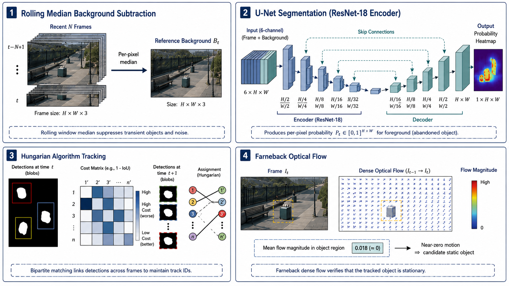
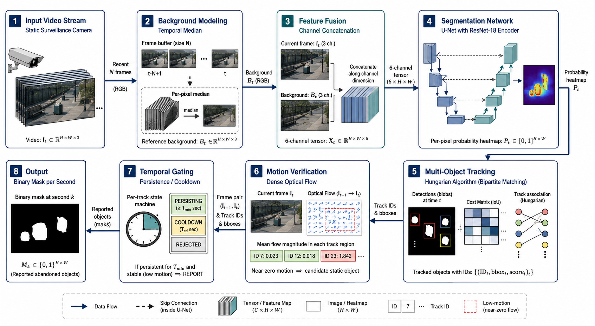
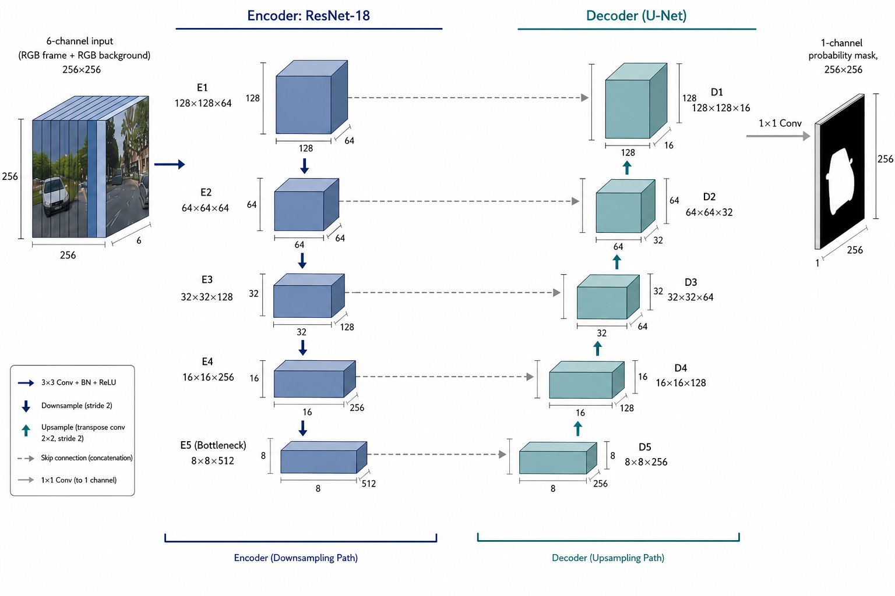
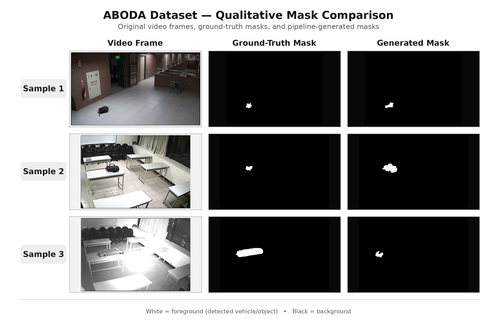

# AOD-Net: A Spatio-Temporal Segmentation Approach for Abandoned Object Detection in Videos

Code for our CVIP 2026 paper (see `paper/`).





## What it does
Given a fixed-camera video plus a persistence threshold P and cooldown C (seconds),
it writes one binary mask per second marking objects that were left behind and
stayed still for at least P seconds, shown for C seconds after that.

1. Rolling-median background model
2. U-Net (ResNet-18 encoder) on frame + background (6 channels) -> per-pixel probability map
3. Hungarian-algorithm tracking of detected blobs across frames
4. Farneback optical-flow check that each track is actually still
5. Persistence/cooldown (P/C) timing gate

## Results (final model)
U-Net, ResNet-18 encoder, encoder depth 5, seed 42, fp32.

| Setting | Precision | Recall | F1 | IoU |
|---|---|---|---|---|
| Per-frame, held-out validation videos | 0.702 | 0.390 | 0.502 | 0.335 |

Full pipeline on all 26 videos: mean pixel F1 0.744, mean IoU 0.652,
mean second-level detection accuracy 0.902. 2 of 26 videos had zero detections.

## ABODA benchmark

Mean pixel IoU 0.617, mean pixel F1 0.677, mean second-level detection accuracy 0.925.

## Setup
```
python -m venv .venv
.venv\Scripts\activate
pip install -r requirements.txt
```
A CUDA GPU is recommended for training. Inference runs on CPU, just slowly.

## Weights
Create a `weights/` folder and put `aod_net_final.pt` in it.

## Data (not included)
Videos and masks are not in this repo. Training and evaluation expect:
```
dataset/
  sample_001/
    video_1.mp4
    video_1.txt     # P, C, and "maskN.png: 65s-109s" style intervals
    mask2.png       # ground-truth shapes
```
Running the model on a new video needs none of this, only the video.

## Usage
Detect on a new video (no labels needed):
```
python scripts/infer.py --video my_video.mp4 --out outputs/my_video --model weights/aod_net_final.pt --p 60 --c 90 --architecture unet --encoder_depth 5
```
Train:
```
python scripts/dataset_prep.py --dataset_root dataset --out training_data
python scripts/train.py --data_root training_data --epochs 40 --out_dir runs/my_run --seed 42 --disable_amp
```
Evaluate on a dataset that has ground truth:
```
python scripts/run_pipeline.py --dataset_root dataset --out_root pipeline_out --model weights/aod_net_final.pt --architecture unet --encoder_depth 5
```
Pass `--architecture` and `--encoder_depth` matching the checkpoint, or the pipeline stops before running.

## Scripts
| Script | Purpose |
|---|---|
| `dataset_prep.py` | Videos + sparse mask intervals -> dense per-frame training data |
| `train.py` | Trains the U-Net (or DeepLabV3+) |
| `infer.py` | Model + tracking + optical flow + P/C rule -> per-second masks |
| `evaluate_predictions.py` | Scores predicted masks against ground truth |
| `run_pipeline.py` | Prep/train/infer/evaluate in one command |
| `diagnose.py` | Per-frame probability maps for debugging |
| `review_output.py` | Overlay montage of detections |
| `check_split.py` | Shows the train/val video split for a seed |
| `yolo_prepare_data.py`, `yolo_evaluate.py` | Same-split comparison against YOLO26 |
| `click_annotate.py`, `sam2_generate_*.py` | Optional SAM2-assisted labeling |

## Ablations (details in the paper)
Encoder depth 4, ASPP/DeepLabV3+, SAM2 labels, pos_weight, gradient clipping and
fp32 vs mixed precision were all tried. None replaced the final configuration.
These runs used an earlier training split, so their numbers are not directly
comparable to the table above.

## Limitations
- Very small objects (<1% of the frame) are the hardest case.
- Busy traffic scenes break the background model.
- One video has poor timing accuracy despite decent masks.

## Citation
```
@inproceedings{aodnet2026,
    title     = {AOD-Net: A Spatio-Temporal Segmentation Approach for Abandoned Object Detection in Videos},
    author    = {Mahala, Arpit and Mukherjee, Prerana and Kurkiya, Rishik},
    note      = {Accepted at CVIP 2026},
    year      = {2026}
  }
```